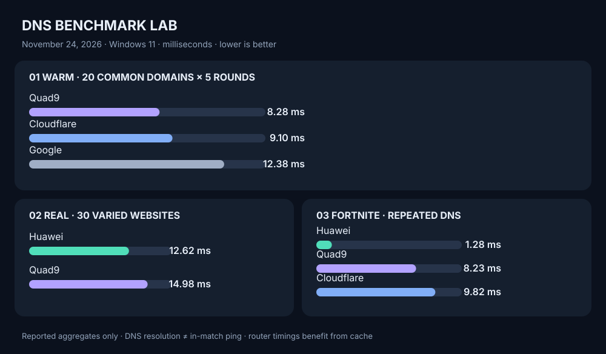
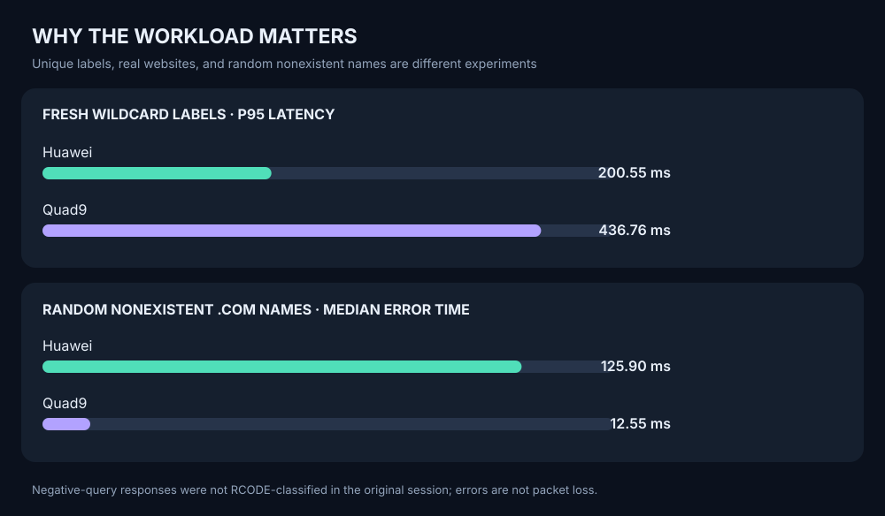

<div align="center">

# DNS Benchmark Lab

**I tried to optimize my ISP router. Then it started winning the benchmarks.**

Windows PowerShell · Huawei vs Quad9 vs Cloudflare · DNS caching · regional gaming endpoints



</div>

## TL;DR

A Windows 11 wired desktop on a Huawei EchoLife HG8245W5-6T was used to compare router-default DNS (`192.168.100.1`), Quad9, Cloudflare, and Google on November 24, 2026. The punchline: **the fastest resolver depends heavily on the workload**.

- **Warm multi-domain lookups:** Quad9 led the public resolvers with an **8.28 ms median** (Cloudflare: 9.10 ms; Google: 12.38 ms).
- **Repeated single-domain lookups:** the router-local DNS path averaged **1.56 ms**, likely because of caching.
- **30 varied real websites:** Huawei achieved **12.62 ms median** vs Quad9's **14.98 ms**, with 29/30 successful lookups for both.
- **Fresh wildcard names:** Huawei's median was **195.98 ms** vs Quad9's **207.07 ms**; these unusual authoritative-domain workloads are not representative of normal browsing.
- **Random likely-nonexistent `.com` domains:** Quad9 returned errors faster (12.55 ms median vs Huawei's 125.90 ms). The original script did not distinguish NXDOMAIN from other DNS errors, so these are **not** verified negative-resolution success rates.
- **Fortnite São Paulo regional hostname:** each resolver returned the same four diagnostic endpoint IPs. The router's repeated DNS lookup median was **1.28 ms**, while direct ICMP tests to the returned IPs were stable at **8–10 ms**.

**Bottom line:** for this particular setup, automatic router DNS was a strong choice, but **there is no evidence that swapping DNS will decrease actual in-match ping**.

## Benchmark scoreboard

| Workload | Huawei (router DNS) | Quad9 | Cloudflare | Google |
|---|---:|---:|---:|---:|
| Warm varied domains · median | — | **8.28 ms** | 9.10 ms | 12.38 ms |
| Repeat `github.com` · average | **1.56 ms** | 8.20 ms | 9.35 ms | 15.25 ms |
| Real varied domains · median | **12.62 ms** | 14.98 ms | — | — |
| Unique wildcard hostnames · median | **195.98 ms** | 207.07 ms | — | — |
| Random nonexistent names · median error time | 125.90 ms | **12.55 ms** | — | — |
| Fortnite regional hostname · median | **1.28 ms** | 8.23 ms | 9.82 ms | — |

*Values are transcribed from the user's November 24, 2026 PowerShell outputs. We have aggregate tables, not the original raw request traces. See [results](results/2026-11-24-dns-summary.csv) and [measurement context](results/2026-11-24-environment.md).*



## Run the benchmarks yourself

**Requirements:** Windows PowerShell 5.1+ (Windows 11 works), network access, and access to the resolver IPs. No external modules or administrator privileges required for the benchmarks. These scripts **never change** your configured system DNS.

Open PowerShell in this repository directory:

```powershell
# Quick set: warm, real-domain, and Fortnite DNS tests
.\scripts\Quickstart.ps1

# Alternatively, target individual workloads:
.\scripts\Invoke-DnsBenchmark.ps1 -Mode Warm -Resolvers Huawei,Quad9,Cloudflare,Google
.\scripts\Invoke-DnsBenchmark.ps1 -Mode RealDomains -Resolvers Huawei,Quad9
.\scripts\Invoke-DnsBenchmark.ps1 -Mode FreshLabels -Resolvers Huawei,Quad9 -Iterations 100
.\scripts\Invoke-DnsBenchmark.ps1 -Mode Negative -Resolvers Huawei,Quad9 -Iterations 50
.\scripts\Invoke-DnsBenchmark.ps1 -Mode Fortnite -Resolvers Huawei,Quad9,Cloudflare

# Diagnostic ICMP latency (does not represent gameplay UDP latency)
.\scripts\Test-GameEndpoints.ps1 -TargetSet Fortnite -Count 30
```

`Huawei` is **not** a geographically located resolver; the default means the local router at `192.168.100.1`. If your router has a different IP, override it:

```powershell
.\scripts\Invoke-DnsBenchmark.ps1 -Mode Warm -Resolvers Huawei,Quad9 -HuaweiDns '192.168.1.1'
```

Output is a timestamped **per-query raw CSV** plus a summary CSV under `runs/` (ignored by Git until you review it). Each row records the query, resolver, measured elapsed time, outcome, and returned A records. If a script fails because of a DNS filter or blocked test domain, the failure is recorded rather than assumed to be packet loss.

If Windows blocks script execution, review the script first and then use a process-scoped policy rather than permanently weakening PowerShell security:

```powershell
Set-ExecutionPolicy -Scope Process -ExecutionPolicy Bypass
```

## Fortnite regional diagnostic IPs

`ping-sao.ds.on.epicgames.com` resolved to the same four A records for Huawei, Quad9, and Cloudflare. Results from 30 Windows ICMP echoes per endpoint:

| IP | Min | Average | Max | Received |
|---|---:|---:|---:|---:|
| `15.228.25.118` | 10 ms | 10 ms | 10 ms | 30/30 |
| `15.228.25.138` | 10 ms | 10 ms | 10 ms | 30/30 |
| `15.228.25.140` | 10 ms | 10 ms | 10 ms | 30/30 |
| `15.228.25.156` | **8 ms** | **8 ms** | **8 ms** | 30/30 |

These are **diagnostic test endpoints, not verified live Fortnite match servers**. RTT values are whole-millisecond Windows readings, not precise jitter measurements. CS2 and VALORANT do not share a single public DNS hostname that reliably stands in for any particular match's latency.

## Why the router looked impossibly fast

The PC used `192.168.100.1` for DNS. This is a router-local DNS proxy/forwarder address, which can answer familiar questions from cache without making a fresh upstream request. The real ISP upstream DNS address was **not** identified; the fact that Huawei manufactured the router does not mean the DNS servers are in China.

A fast DNS lookup can help with a *new connection* to a named service. After the IP address is known, gameplay network latency depends on routing, congestion, server location, and packet transport—not on the DNS server used earlier.

## What was actually learned?

Different workloads produce different winners. A cached 1 ms response and a 200 ms one-off resolution cannot be interpreted as the same kind of benchmark. Likewise, querying fake domains mostly times negative/error handling. When performing new tests, check **response status** and **returned IPs** as well as speed.

Read the detailed [methodology and limitations](docs/methodology.md) before reusing these results as evidence.

## Repository layout

```text
dns-benchmark-lab/
├── README.md
├── LICENSE
├── .gitignore
├── scripts/
│   ├── Quickstart.ps1
│   ├── Invoke-DnsBenchmark.ps1
│   └── Test-GameEndpoints.ps1
├── docs/
│   └── methodology.md
├── results/
│   ├── 2026-11-24-dns-summary.csv
│   ├── 2026-11-24-fortnite-icmp.csv
│   └── 2026-11-24-environment.md
└── charts/
    ├── dns-overview.svg
    └── latency-tails.svg
```

## Reproduce responsibly

Avoid uploading WAN IPs, serial numbers, MAC addresses, router credentials, or packet captures that expose personal traffic. This repository contains **public DNS endpoints, a local RFC1918 router address, aggregate test results, and no original router screenshots**.

## License

MIT for the scripts and documentation. Results are attributed to the November 24, 2026 user experiment and are provided without independent verification.
